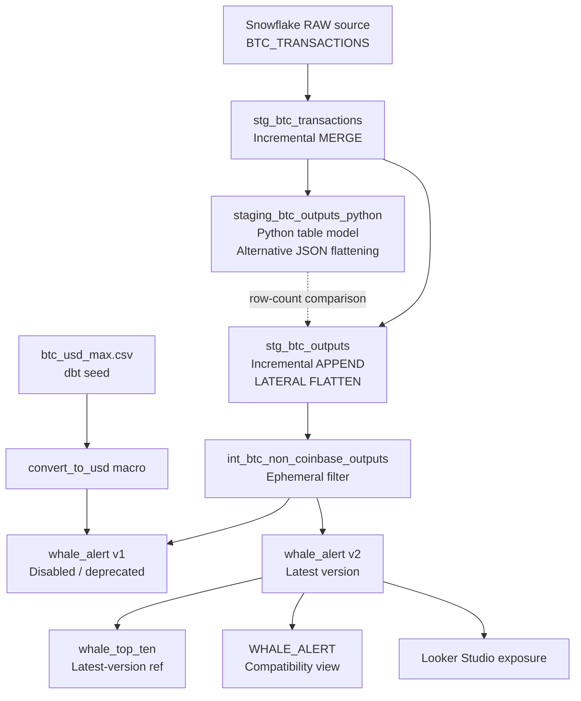

# Bitcoin (BTC) Data Engineering Pipeline

A Snowflake and dbt project that transforms raw Bitcoin transaction data into analytics-ready output records and a wallet-level **Whale Alert** mart. The project demonstrates layered data modeling, incremental processing, semi-structured JSON flattening, reusable dbt macros, data quality tests, a Snowflake-hosted Python model, model versioning, and pull-request CI with GitHub Actions.

> **Project status:** The SQL pipeline and parallel Python output model have been built and validated in Snowflake. Whale Alert model versioning, a latest-version compatibility view, dbt exposures, custom tests, package dependencies, and GitHub Actions CI have also been added. A pull request from `dev2` to `main` completed its CI check successfully. Confirm the pull request's merge status in GitHub before assuming those changes are present on `main`.
>
> **CI scope:** The current GitHub Actions workflow runs `dbt debug`, `dbt deps`, and `dbt run` against the default `dev` target. It does not currently run `dbt test` or deploy to the `prod` target.

---

## Table of contents

- [Project overview](#project-overview)
- [Architecture](#architecture)
- [Technology stack](#technology-stack)
- [Data sources](#data-sources)
- [Project structure](#project-structure)
- [Data models](#data-models)
- [Seeds and reusable macros](#seeds-and-reusable-macros)
- [Data quality and validation](#data-quality-and-validation)
- [Model versioning and compatibility view](#model-versioning-and-compatibility-view)
- [dbt exposure and dashboard](#dbt-exposure-and-dashboard)
- [Snowflake environments](#snowflake-environments)
- [Local setup](#local-setup)
- [Running the project](#running-the-project)
- [Using dbt state and defer](#using-dbt-state-and-defer)
- [GitHub Actions CI](#github-actions-ci)
- [Git workflow](#git-workflow)
- [Known limitations and engineering considerations](#known-limitations-and-engineering-considerations)
- [Potential next steps](#potential-next-steps)
- [Security notes](#security-notes)

---

## Project overview

The pipeline starts with transaction-level Bitcoin data stored in a raw Snowflake table. dbt models prepare the transaction records, expand the nested `OUTPUTS` JSON array into individual output rows, exclude Coinbase transactions for downstream analysis, and aggregate qualifying output activity by Bitcoin address.

The Whale Alert mart is versioned. Version 2 is configured as the latest version and provides:

- Bitcoin output address.
- Total qualifying Bitcoin output value per address.
- Count of qualifying output rows per address.

The earlier V1 model also calculated an estimated USD value using the latest available non-null closing price in the project seed. V1 is disabled in the current dbt model-version configuration; V2 excludes that USD column.

The project also contains a Python implementation of the JSON-output transformation. It uses pandas and simplejson in a Snowflake-hosted dbt Python model and provides a practical comparison with the SQL-based `LATERAL FLATTEN` implementation.

### Project objectives

1. Build a layered dbt transformation pipeline on Snowflake.
2. Use dbt `source()` and `ref()` to define source relationships and model dependencies.
3. Process transaction data with incremental `MERGE` and `APPEND` strategies.
4. Flatten semi-structured Bitcoin transaction outputs.
5. Reuse transformation logic through an ephemeral intermediate model and custom macros.
6. Apply dbt data quality tests, including a custom Bitcoin address test.
7. Implement and validate a Python dbt model alongside the SQL implementation.
8. Use dbt model versions and a compatibility view to manage downstream dependencies.
9. Document a Looker Studio dashboard as a dbt exposure.
10. Use Git branches, pull requests, and GitHub Actions to validate changes before merging to `main`.

---

## Architecture

The main transformation flow is:



The Python model is a **parallel implementation for learning and comparison**. The downstream Whale Alert models continue to use the SQL intermediate model `int_btc_non_coinbase_outputs`; they do not currently consume the Python model's output. The Python model is used as a comparison target by a row-count test.

### Logical layers

| Layer | Responsibility | Implemented resources |
|---|---|---|
| Raw | Stores source Bitcoin transaction data | `BTC_DEV.RAW.BTC_TRANSACTIONS` |
| Staging | Standardizes transaction records and expands transaction outputs | `stg_btc_transactions`, `stg_btc_outputs` |
| Intermediate | Applies reusable business filtering | `int_btc_non_coinbase_outputs` |
| Marts | Produces aggregated, analytics-oriented results | `whale_alert` V1/V2, `whale_top_ten` |
| Supporting assets | Supplies reference data and reusable SQL logic | `btc_usd_max` seed, `convert_to_usd` macro, compatibility-view macro |
| Analytics metadata | Documents downstream dashboard dependencies | `models/exposures.yml` |

The intermediate model is logically part of the intermediate layer, although its SQL file is currently stored under `models/staging/` in the repository.

---

## Technology stack

| Technology | Role in the project |
|---|---|
| Snowflake | Cloud data warehouse and execution platform |
| dbt Core 1.9.4 | SQL/Python model orchestration, dependency management, tests, and compilation |
| dbt-snowflake 1.9.4 | dbt adapter for Snowflake |
| Python 3.12 | Local dbt command-line runtime and GitHub Actions runtime |
| pandas | DataFrame manipulation in the Snowflake Python model |
| PyArrow | Supports pandas data transfer through the Snowflake Connector |
| simplejson | Parses JSON values in the Python model |
| dbt-utils 1.4.1 | Provides reusable dbt tests, including `equal_rowcount` |
| Git and GitHub | Version control, pull requests, and CI workflow execution |
| GitHub Actions | Runs dbt connection, dependency, and model-build checks for pull requests |
| Looker Studio | Dashboard documented through a dbt exposure |

The Python model declares `pandas`, `pyarrow`, and `simplejson` in its dbt package configuration. Those packages are made available in the Snowflake Python execution environment for that model; pandas does not need to be installed locally just to execute the model.

---

## Data sources

The dbt source is defined in `models/sources.yml` under the source name `btc`.

| Database | Schema | Source table | Use |
|---|---|---|---|
| `BTC_DEV` | `RAW` | `BTC_TRANSACTIONS` | Primary source used by `stg_btc_transactions` |
| `BTC_DEV` | `RAW` | `BTC_TRANSACTIONS_REGEX` | Additional raw source declared in the source configuration; not used by the current primary model flow |

The primary source contains transaction-level fields, including:

- `TRANSACTION_HASH`
- `BLOCK_HASH`
- `BLOCK_TIMESTAMP`
- `FEE`
- `INPUT_VALUE`
- `OUTPUT_VALUE`
- `FEE_PER_BYTE`
- `IS_COINBASE`
- `OUTPUTS` — semi-structured output data containing an array of JSON objects, including address and value fields.

Source freshness is configured for `BTC_TRANSACTIONS` using `BLOCK_TIMESTAMP`, with a warning threshold of one hour and an error threshold of three hours. The source data observed during project validation was not recent enough to satisfy those thresholds. Freshness therefore depends on the upstream raw-data loading process continuing to update the source.

The upstream raw ingestion process is outside the scope of the dbt transformations documented here. The models expect the raw source table to be populated before dbt runs.

---

## Project structure

The key project files and folders are:

```text
BTC/
├── .github/
│   └── workflows/
│       └── dbt-ci.yml                  # Pull-request CI workflow
├── dbt_project.yml
├── packages.yml                        # dbt package declarations
├── package-lock.yml                    # Resolved dbt package versions
├── models/
│   ├── sources.yml
│   ├── schema.yml                       # Tests, contracts, and model versions
│   ├── exposures.yml                    # Looker Studio dashboard exposure
│   ├── staging/
│   │   ├── stg_btc_transactions.sql
│   │   ├── stg_btc_outputs.sql
│   │   ├── int_btc_non_coinbase_outputs.sql
│   │   └── staging_btc_outputs_python.py
│   └── marts/
│       ├── whale_alert_v1.sql
│       ├── whale_alert_v2.sql
│       └── whale_top_ten.sql
├── macros/
│   ├── btc_utils.sql                    # convert_to_usd macro
│   └── create_latest_version_view.sql  # Latest-version compatibility view
├── seeds/
│   └── btc_usd_max.csv
├── tests/
│   └── generic/
│       └── crypto_utils.sql             # Bitcoin address generic test
├── state/
│   └── manifest.json                    # Saved dbt state for defer workflows
└── target/                              # Generated dbt artifacts; recreated by dbt
```

`target/`, `dbt_packages/`, logs, virtual environments, and local credentials are generated or machine-specific assets and should not be treated as application source code. The `state/manifest.json` file is a reference manifest used for the defer workflow; refresh it from the intended reference environment when needed.

---

## Data models

### 1. `stg_btc_transactions`

**File:** `models/staging/stg_btc_transactions.sql`  
**Materialization:** Incremental  
**Incremental strategy:** `merge`  
**Unique key:** `TRANSACTION_HASH`

Reads the raw `BTC_TRANSACTIONS` source using `source('btc', 'BTC_TRANSACTIONS')` and retains the transaction-level columns, including the semi-structured `OUTPUTS` field.

On incremental runs, the model filters source records to timestamps greater than the maximum `BLOCK_TIMESTAMP` already present in the target relation (`{{ this }}`). dbt uses `TRANSACTION_HASH` as the merge key to update matching records and insert new keys among the records selected by the query.

### 2. `stg_btc_outputs`

**File:** `models/staging/stg_btc_outputs.sql`  
**Materialization:** Incremental  
**Incremental strategy:** `append`

Reads from `stg_btc_transactions` and uses Snowflake `LATERAL FLATTEN(INPUT => t.OUTPUTS)` to expand the JSON output array into individual rows. It extracts:

- `OUTPUT_ADDRESS` from `f.VALUE:address::STRING`.
- `OUTPUT_VALUE` from `f.VALUE:value::FLOAT`.

It also carries through `TRANSACTION_HASH`, `BLOCK_TIMESTAMP`, and `IS_COINBASE`, and filters out output objects without an address.

For incremental runs, it applies a timestamp filter against the latest `BLOCK_TIMESTAMP` already in the target table. The `append` strategy inserts the selected rows; it does not update or deduplicate existing output rows.

### 3. `int_btc_non_coinbase_outputs`

**File:** `models/staging/int_btc_non_coinbase_outputs.sql`  
**Materialization:** Ephemeral

Selects all columns from `stg_btc_outputs` and filters to:

```sql
WHERE IS_COINBASE = FALSE
```

Because the model is ephemeral, dbt does not create a separate physical Snowflake table or view for it. Its SQL is incorporated into downstream models that reference it.

### 4. `staging_btc_outputs_python`

**File:** `models/staging/staging_btc_outputs_python.py`  
**Materialization:** Table  
**Execution:** Snowflake-hosted dbt Python model

Implements an alternative JSON-flattening workflow using pandas and simplejson:

1. Reads `stg_btc_transactions` through `dbt.ref(...).to_pandas()`.
2. Parses the `OUTPUTS` JSON strings with `simplejson.loads`.
3. Expands output arrays with pandas `explode()`.
4. Extracts `address` and `value` using `pandas.json_normalize()`.
5. Combines the extracted fields with the original transaction columns.
6. Filters rows with null addresses.
7. Converts column names to uppercase and returns the final DataFrame.

The model configuration requests `pandas`, `pyarrow`, and `simplejson` packages. PyArrow was added after the first execution failed during the Snowflake Connector's pandas fetch operation with an optional pandas dependency error. With PyArrow included, the model executed successfully.

**Schema naming difference:** The Python model outputs `ADDRESS` and `VALUE`; the SQL model `stg_btc_outputs` outputs `OUTPUT_ADDRESS` and `OUTPUT_VALUE`. They represent corresponding extracted fields but do not currently have identical column names.

### 5. `whale_alert` V1 and V2

**Files:**

- `models/marts/whale_alert_v1.sql`
- `models/marts/whale_alert_v2.sql`

Both versions aggregate non-Coinbase output records by `OUTPUT_ADDRESS`. The current business filter is applied to individual output rows before aggregation:

```sql
OUTPUT_VALUE > 10
```

V1 calculates:

- `OUTPUT_ADDRESS`
- `TOTAL_SENT`
- `TRANSACTION_COUNT`
- `TOTAL_SENT_USD`

V2 is the configured latest version and contains three columns:

- `OUTPUT_ADDRESS`
- `TOTAL_SENT`
- `TRANSACTION_COUNT`

The model contract is enforced for the versioned Whale Alert model. Version 2 excludes `TOTAL_SENT_USD` from its output.

**Counting clarification:** `COUNT(*)` counts qualifying output rows. It does not count distinct transaction hashes, even though the output column is currently named `TRANSACTION_COUNT`.

### 6. `whale_top_ten`

**File:** `models/marts/whale_top_ten.sql`

This downstream mart references `whale_alert` without pinning a specific version. Because V2 is configured as the latest version, the unpinned reference resolves to V2. This model demonstrates how downstream models can follow the configured latest version.

---

## Seeds and reusable macros

### Seed: `btc_usd_max`

**File:** `seeds/btc_usd_max.csv`

The seed contains Bitcoin market reference data, including:

- `EVENT_DATE`
- `CLOSE_PRICE_USD`
- `MARKET_CAP_USD`
- `VOLUME_USD`

The CSV is loaded into Snowflake by dbt using `dbt seed`.

### Macro: `convert_to_usd`

**File:** `macros/btc_utils.sql`

The `convert_to_usd(column_name)` macro accepts a SQL expression, retrieves the latest row with a non-null `CLOSE_PRICE_USD` from the `btc_usd_max` seed, and multiplies the supplied Bitcoin amount by that price.

The macro cleans the `EVENT_DATE` text by removing the ` UTC` suffix, converts it to a date with `TRY_TO_DATE`, sorts newest first, and uses `LIMIT 1` to select one closing-price row.

V1 used the macro as:

```sql
{{ convert_to_usd('w.TOTAL_SENT') }} AS TOTAL_SENT_USD
```

The macro uses one latest available price for all addresses in the result. It does not perform historical price lookup by transaction date. V2 does not include the USD column.

### Macro: `create_latest_version_view`

**File:** `macros/create_latest_version_view.sql`

This macro is called through the model post-hook configuration in `dbt_project.yml`. For the latest versioned model, it creates or replaces an unversioned compatibility view using the model's base name and selects from the latest versioned relation.

For example, in the `dev2` target, the compatibility relation is:

```text
BTC_DEV.DBT_MARK.WHALE_ALERT
```

It points to the latest versioned Whale Alert model (`WHALE_ALERT_V2`). In the CI `dev` target, the corresponding relation is created in `BTC_DEV.DBT_DEVELOPMENT`.

The compatibility view allows consumers that refer to the unversioned relation name to use the latest model output. Review this macro and the target schema before applying model changes to a production target.

---

## Data quality and validation

### Configured tests

The current dbt project includes these validation patterns:

| Model / field | Test | Purpose |
|---|---|---|
| `stg_btc_transactions.transaction_hash` | `unique` | Detect duplicate transaction hashes |
| `stg_btc_transactions.transaction_hash` | `not_null` | Ensure transaction hashes are populated |
| `stg_btc_outputs` | `dbt_utils.equal_rowcount` against `staging_btc_outputs_python` | Compare row counts from the SQL and Python output implementations |
| `whale_alert.output_address` | `assert_valid_btc_address` | Apply the project's custom Bitcoin address prefix check |

The custom `assert_valid_btc_address` generic test is defined in `tests/generic/crypto_utils.sql`. It checks for supported address prefixes (`1`, `3`, and `bc1`). It is a format/prefix check, not full cryptographic validation of a Bitcoin address.

### Model contract

The versioned Whale Alert model uses an enforced dbt contract. The contract declares the expected column names and data types, and V2 excludes the V1-only `TOTAL_SENT_USD` field.

### Python model validation completed

The Python model was successfully executed in the `dev2` target and its resulting table was checked in Snowflake.

| Validation | Observed result |
|---|---:|
| Output row count | 982,507 |
| Rows with null `ADDRESS` | 0 |
| Rows with null `VALUE` | 0 |

A sample of the table was also inspected to confirm that transaction fields were preserved and the extracted address/value fields were populated.

The SQL output model and Python output model had the same observed row count of 982,507 during validation. This is a row-count comparison, not a complete row-by-row equality test.

### Commands for local testing

Run all configured dbt tests with:

```bash
dbt test --target dev2
```

Run tests for a specific model selection with:

```bash
dbt test --target dev2 --select whale_alert
```

---

## Model versioning and compatibility view

The version configuration is maintained in `models/schema.yml`.

- `whale_alert` has `latest_version: 2`.
- V1 is disabled and has a deprecation date of `2026-01-01` in the project configuration.
- V2 is the active latest version.
- The V2 model contract excludes the V1-only `TOTAL_SENT_USD` field.
- `whale_top_ten` uses an unpinned `ref('whale_alert')`, so it follows the configured latest version.
- `models/exposures.yml` pins the dashboard exposure dependency to V2.

The deprecation date is a dbt model-version configuration value; it does not itself delete a previously materialized Snowflake table. A relation left behind from an earlier run may need separate review and cleanup.

The compatibility-view macro maintains the unversioned `WHALE_ALERT` relation as a view of the configured latest version. This is separate from dbt's versioned model relations.

---

## dbt exposure and dashboard

**Configuration:** `models/exposures.yml`  
**Dashboard:** BTC Whale Alert Dashboard  
**Tool:** Looker Studio

The exposure documents the downstream dashboard dependency on `whale_alert` version 2. This makes the dashboard relationship visible in dbt's project metadata and lineage documentation.

The dashboard has been connected to the Snowflake Whale Alert output. Since V2 no longer includes `TOTAL_SENT_USD`, refresh the Looker Studio data source/schema and review any charts or calculated fields that depended on that removed column.

---

## Snowflake environments

The dbt profile is named `BTC`. The project uses the `BTC_DEV` database and a Snowflake role and warehouse configured in the local profile.

| dbt target | Output schema | Purpose |
|---|---|---|
| `dev` | `DBT_DEVELOPMENT` | CI and development workspace |
| `dev2` | `DBT_MARK` | Separate development/experimentation workspace |
| `prod` | `DBT_PRODUCTION` | Production-target schema |

The known profile configuration uses `DBT_DEVELOPER_ROLE` and `COMPUTE_WH`. The target can be selected on the command line with `--target`. For example:

```bash
dbt debug --target dev2
```

The exact account identifier, user, private-key path, and key passphrase are intentionally not included in this repository README. They belong in the developer's local dbt profile and secure environment configuration.

---

## Local setup

### Prerequisites

- Access to the Snowflake account and required database objects.
- Python 3.12 for the local dbt command-line environment.
- dbt Core 1.9.4.
- dbt-snowflake 1.9.4.
- A configured Snowflake key-pair authentication setup.

### 1. Clone the repository

```bash
git clone https://github.com/makt96/btc-pipeline.git
cd btc-pipeline
```

### 2. Create and activate a virtual environment

The following is a standard local setup. Use your preferred virtual-environment location if you already have one.

```bash
python3.12 -m venv .venv
source .venv/bin/activate
python -m pip install --upgrade pip
```

### 3. Install dbt and the Snowflake adapter

```bash
python -m pip install dbt-core==1.9.4 dbt-snowflake==1.9.4
```

Check the installation:

```bash
dbt --version
```

### 4. Install dbt packages

From the directory containing `dbt_project.yml`, run:

```bash
dbt deps
```

This installs the packages declared in `packages.yml`, including `dbt_utils`.

### 5. Configure the dbt profile

Create or update:

```text
~/.dbt/profiles.yml
```

The profile name must match the `profile:` value in `dbt_project.yml` (`BTC`). A simplified example for the development target is shown below. Replace the placeholders with your own Snowflake account and local key-file details.

```yaml
BTC:
  target: dev
  outputs:
    dev:
      type: snowflake
      account: <YOUR_SNOWFLAKE_ACCOUNT_IDENTIFIER>
      user: <YOUR_SNOWFLAKE_USER>
      role: DBT_DEVELOPER_ROLE
      warehouse: COMPUTE_WH
      database: BTC_DEV
      schema: DBT_DEVELOPMENT
      threads: 1
      private_key_path: <PATH_TO_YOUR_PRIVATE_KEY>
      private_key_passphrase: "{{ env_var('DBT_ENV_SECRET_KEY_PASSPHRASE') }}"
```

Configure the passphrase through your secure local environment or secret manager. Do not place the passphrase directly in the repository.

The actual profile also has `dev2` and `prod` outputs mapped to `DBT_MARK` and `DBT_PRODUCTION`, respectively. Add those targets to your local profile if you need to run against those schemas.

### 6. Validate the connection

```bash
dbt debug --target dev
```

Use `--target dev2` or `--target prod` when validating those environments.

---

## Running the project

Run commands from the directory containing `dbt_project.yml`.

### Load the seed

```bash
dbt seed --target dev2
```

### Run all enabled models

```bash
dbt run --target dev2
```

### Run a specific model

```bash
dbt run --target dev2 --select stg_btc_transactions
```

```bash
dbt run --target dev2 --select stg_btc_outputs
```

```bash
dbt run --target dev2 --select whale_alert
```

### Run the Python model

```bash
dbt run --target dev2 --select staging_btc_outputs_python
```

When its upstream transaction model is not built in the selected development schema, use the state/defer workflow described below, provided the referenced relation exists in the target state manifest.

### Run data quality tests

```bash
dbt test --target dev2
```

### Compile the project

```bash
dbt compile --target dev2
```

Compilation renders dbt/Jinja code into executable SQL or Python model artifacts under `target/`. Generated files in `target/` are build artifacts, not the source files to edit.

> **Production caution:** `dbt run --target prod` writes to the production-target schema. Review the model selection, hooks, and generated SQL before running production commands. The compatibility-view post-hook can create or replace the unversioned `WHALE_ALERT` view in the selected target schema.

---

## Using dbt state and defer

The project has used dbt's `--defer` option to develop in `DBT_MARK` while resolving unbuilt upstream references to relations in the production target.

A saved production manifest is kept in `state/manifest.json` for this workflow. To refresh the reference manifest from the production target:

```bash
dbt compile --target prod
mkdir -p state
cp target/manifest.json state/manifest.json
```

Then a downstream model can be run in `dev2` while deferring eligible upstream references to the relations described by the saved manifest:

```bash
dbt run --target dev2 --select whale_alert --defer --state state
```

The Python model was also successfully run with this pattern:

```bash
dbt run --target dev2 --select staging_btc_outputs_python --defer --state state
```

**Important:** `--defer` does not create missing production tables. The referenced relations must already exist in the target described by the state manifest. Keep the manifest aligned with the environment you intend to use as the reference state.

---

## GitHub Actions CI

**Workflow file:** `.github/workflows/dbt-ci.yml`  
**Workflow name:** `BTC dbt Continuous Integration`  
**GitHub environment:** `DB_BTC`

The workflow runs when a pull request targets `main`:

```yaml
on:
  pull_request:
    branches:
      - main
```

### What the workflow does

1. Checks out the repository.
2. Sets up Python 3.12.16.
3. Installs dbt Core 1.9.4 and dbt-snowflake 1.9.4.
4. Creates the runner's dbt profile and encrypted RSA private-key file from GitHub environment secrets.
5. Runs `dbt debug` to verify the Snowflake connection.
6. Runs `dbt deps` to install dbt packages.
7. Runs `dbt run` to build enabled dbt models.

### GitHub environment secrets

The `DB_BTC` environment uses these secret names:

| Secret | Purpose |
|---|---|
| `DBT_PROFILES_YAML` | dbt profile YAML content for the GitHub runner |
| `DBT_PRIVATE_KEY` | Encrypted RSA private-key content |
| `DBT_ENV_SECRET_KEY_PASSPHRASE` | Passphrase used to decrypt the RSA private key |

Secret **values** must remain in GitHub's environment-secret store and must never be committed to the repository or pasted into issues, pull requests, or chat messages.

The workflow writes the profile to `$HOME/.dbt/profiles.yml` and the key to `$HOME/rsa_key_new.p8`. The GitHub profile secret must therefore use this runner key path:

```yaml
private_key_path: /home/runner/rsa_key_new.p8
private_key_passphrase: "{{ env_var('DBT_ENV_SECRET_KEY_PASSPHRASE') }}"
```

The workflow uses the profile's default `dev` target. In the configured profile, that target writes to `BTC_DEV.DBT_DEVELOPMENT`, using `DBT_DEVELOPER_ROLE` and `COMPUTE_WH`. It does not build in `DBT_MARK` or `DBT_PRODUCTION` unless the workflow/profile is deliberately changed.

### Environment deployment-branch restriction

The `DB_BTC` GitHub environment is configured to allow the pull-request merge ref pattern:

```text
refs/pull/*/merge
```

The workflow itself is also limited to pull requests targeting `main`. Keep the environment rule and workflow trigger aligned if the CI trigger changes.

### Current CI limitation

The current workflow does **not** run `dbt test`, `dbt source freshness`, or a production deployment. Those can be considered as separate improvements after deciding which checks are appropriate for the CI environment and Snowflake permissions.

A pull-request CI run completed successfully during development. That successful run covered the workflow's configured commands (`dbt debug`, `dbt deps`, and `dbt run`).

---

## Git workflow

The repository uses Git branches to separate stable work from ongoing development.

The branch workflow to date includes:

- `main` is the default branch.
- `dev` was used for an earlier development cycle and merged through a pull request.
- `dev2` is the current development branch used for the later model-versioning and CI work.
- The recent `dev2` to `main` pull request completed its GitHub Actions CI check successfully. Confirm its current merge status in GitHub.

Useful commands for checking the local and remote branch state:

```bash
git status
git branch -a
git log --oneline --decorate -10
```

A typical future workflow is:

1. Update the local `main` branch.
2. Create or switch to a focused development branch.
3. Make and validate model changes in a development target.
4. Commit and push the branch.
5. Open a pull request targeting `main`.
6. Review the GitHub Actions CI result.
7. Merge only after the required checks and review are complete.

---

## Known limitations and engineering considerations

The following items describe characteristics of the current implementation. They are documented intentionally so that future improvements can be made without confusing the current behavior with a fully hardened production design.

### 1. Timestamp watermark behavior

The incremental models use a strict greater-than filter:

```sql
BLOCK_TIMESTAMP > (
    SELECT MAX(BLOCK_TIMESTAMP)
    FROM {{ this }}
)
```

Records arriving late with timestamps older than the maximum already loaded can be missed. Records sharing the current maximum timestamp can also be excluded by the strict `>` comparison. The `MERGE` strategy in `stg_btc_transactions` only matches records returned by the incremental query; it cannot update records filtered out before the merge.

### 2. Append behavior in `stg_btc_outputs`

The output model uses `incremental_strategy='append'`. It inserts the rows selected by the incremental query and does not update or deduplicate prior output rows. A production implementation should define how corrections, replayed data, and duplicate output records are handled.

### 3. `TRANSACTION_COUNT` currently counts output rows

In the Whale Alert models, `COUNT(*)` counts qualifying output records grouped by address. It is not a count of distinct transactions. Consider changing the metric name or using `COUNT(DISTINCT TRANSACTION_HASH)` if the intended business definition is distinct transactions.

### 4. The whale filter applies to each output

`WHERE OUTPUT_VALUE > 10` is applied before the address aggregation. It selects individual outputs greater than 10 BTC; it does not select addresses whose combined value is greater than 10 BTC.

### 5. USD valuation is based on one latest seed price

The V1 macro applies the latest available non-null closing price to every aggregated address. It is not a historical valuation by block timestamp. The seed should also contain a deterministic unique latest date/price row; `LIMIT 1` alone does not define a stable choice if multiple rows tie for the latest date.

### 6. Python and SQL output schemas are not identical

The Python model uses `ADDRESS` and `VALUE`; the SQL model uses `OUTPUT_ADDRESS` and `OUTPUT_VALUE`. A future parity check should normalize column naming before treating the two models as interchangeable. The configured `equal_rowcount` test checks only row counts, not row-by-row equality.

### 7. Source freshness depends on upstream ingestion

The source freshness checks use one-hour warning and three-hour error thresholds. The raw source data observed during development was stale relative to those thresholds. Freshness checks will continue to report staleness until the upstream ingestion process updates the source.

### 8. V2 does not include USD valuation

The V2 Whale Alert model intentionally excludes `TOTAL_SENT_USD`. Downstream dashboards and consumers should use the V2 schema and should not assume the V1 USD column is available.

### 9. CI is validation, not production deployment

The current pull-request workflow builds against the `dev` target in `DBT_DEVELOPMENT`. It does not promote models to the `prod` target and does not run the dbt test suite. Treat the successful CI check as validation of the configured commands only.

---

## Potential next steps

These are suggested follow-up engineering tasks, not claims of completed work:

- Add `dbt test` to the CI workflow after confirming the intended test scope and Snowflake permissions.
- Consider adding `dbt source freshness` as a separate check, taking the upstream data freshness expectation into account.
- Add a robust incremental strategy that accounts for late-arriving records and timestamp ties (for example, a lookback window with a suitable merge key).
- Define a stable unique key for individual transaction outputs and test for duplicates.
- Add data quality tests for output values and relevant timestamp fields.
- Add a row-level comparison between the SQL and Python output models, not just a row-count comparison.
- Decide whether `TRANSACTION_COUNT` should represent output count or distinct transaction count.
- Add historical USD pricing by transaction/block date if historical valuation is required.
- Review the `create_latest_version_view` post-hook behavior before enabling it in production.
- Confirm the Looker Studio data source and charts reflect the V2 three-column schema.
- Review GitHub branch protection and required-check settings for `main`.
- Extend model and source documentation with column descriptions and business definitions.

---

## Security notes

- Never commit Snowflake private keys, private-key passphrases, passwords, or access tokens.
- Keep `profiles.yml` in `~/.dbt/`, outside the repository.
- Keep private-key files outside the repository and restrict their filesystem permissions.
- Use the `DBT_ENV_SECRET_KEY_PASSPHRASE` environment variable or an approved secret manager for the private-key passphrase.
- Store CI credentials only as GitHub environment secrets; never place their values in this README or workflow source.
- The repository `.gitignore` includes patterns for private keys and local dbt profile files. Continue reviewing `git status` before committing.
- Do not commit raw customer-sensitive or otherwise restricted datasets unless explicitly approved.
- Review staged changes before committing to ensure credentials, local environment files, and generated artifacts are not included.

---

## Project summary

This repository captures an end-to-end learning implementation of a Snowflake/dbt Bitcoin analytics pipeline: raw transaction data is staged, nested output arrays are flattened, non-Coinbase outputs are isolated, wallet-level activity is aggregated, and V1 USD estimates are calculated through a reusable macro. The project also demonstrates dbt incremental models, ephemeral models, seeds, schema contracts, generic and package-provided tests, a parallel Python model, model versioning, compatibility views, dbt exposures, deferred development against a saved state manifest, and pull-request CI with GitHub Actions.

The CI workflow currently validates the Snowflake connection, installs dbt packages, and builds the default development target. Extending automated tests and defining a controlled production promotion process are logical future improvements.
