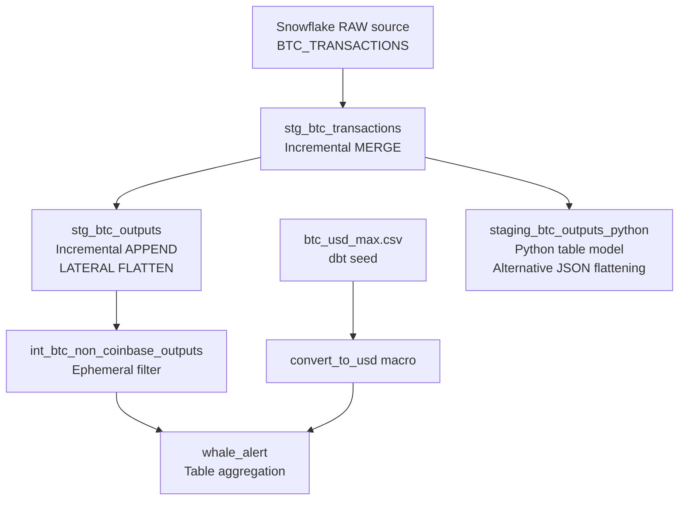

# Bitcoin (BTC) Data Engineering Pipeline

A Snowflake and dbt project that transforms raw Bitcoin transaction data into analytics-ready output records and a wallet-level **Whale Alert** mart. The project demonstrates layered data modeling, incremental processing, semi-structured JSON flattening, reusable dbt macros, data quality tests, and a Python model executed in Snowflake.

> **Project status:** The core SQL pipeline has been built and successfully run in Snowflake. A parallel dbt Python model has also been executed successfully in the development workspace and its output has been validated. This README documents the implementation and validation completed to date; it does not imply that every production-hardening item listed below has been implemented.

---

## Table of contents

- [Project overview](#project-overview)
- [Architecture](#architecture)
- [Technology stack](#technology-stack)
- [Data sources](#data-sources)
- [Project structure](#project-structure)
- [Data models](#data-models)
- [Python model](#python-model)
- [Seed and reusable macro](#seed-and-reusable-macro)
- [Data quality and validation](#data-quality-and-validation)
- [Snowflake environments](#snowflake-environments)
- [Local setup](#local-setup)
- [Running the project](#running-the-project)
- [Using dbt state and defer](#using-dbt-state-and-defer)
- [Git workflow](#git-workflow)
- [Known limitations and engineering considerations](#known-limitations-and-engineering-considerations)
- [Potential next steps](#potential-next-steps)
- [Security notes](#security-notes)

---

## Project overview

The pipeline starts with transaction-level Bitcoin data stored in a raw Snowflake table. dbt models prepare the transaction records, expand the nested `OUTPUTS` JSON array into individual output rows, exclude Coinbase transactions for downstream analysis, and aggregate qualifying output activity by Bitcoin address.

The final `whale_alert` mart provides:

- Bitcoin output address.
- Total qualifying Bitcoin output value per address.
- Count of qualifying output rows per address.
- Estimated USD value using the latest available non-null closing price in the project seed.

The project also contains a Python implementation of the JSON-output transformation. It uses pandas and simplejson in a Snowflake-hosted dbt Python model and provides a practical comparison with the SQL-based `LATERAL FLATTEN` implementation.

### Project objectives

1. Build a layered dbt transformation pipeline on Snowflake.
2. Use dbt `source()` and `ref()` to define source relationships and model dependencies.
3. Process transaction data with incremental `MERGE` and `APPEND` strategies.
4. Flatten semi-structured Bitcoin transaction outputs.
5. Reuse transformation logic through an ephemeral intermediate model and a custom macro.
6. Apply dbt data quality tests to important transaction identifiers.
7. Implement and validate a Python dbt model alongside the SQL implementation.
8. Use separate development and production schemas and Git branches to support controlled changes.

---

## Architecture

The main SQL data flow is:



The Python model is currently a **parallel implementation for learning and comparison**. The downstream `whale_alert` model continues to reference the SQL intermediate model `int_btc_non_coinbase_outputs`; it does not currently consume the Python model's output.

### Logical layers

| Layer | Responsibility | Implemented resources |
|---|---|---|
| Raw | Stores source Bitcoin transaction data | `BTC_DEV.RAW.BTC_TRANSACTIONS` |
| Staging | Standardizes transaction records and expands transaction outputs | `stg_btc_transactions`, `stg_btc_outputs` |
| Intermediate | Applies reusable business filtering | `int_btc_non_coinbase_outputs` |
| Marts | Produces aggregated, analytics-oriented results | `whale_alert` |
| Supporting assets | Supplies reference data and reusable SQL logic | `btc_usd_max` seed, `convert_to_usd` macro |

The intermediate model is logically part of the intermediate layer, although its SQL file is currently stored under `models/staging/` in the repository.

---

## Technology stack

| Technology | Role in the project |
|---|---|
| Snowflake | Cloud data warehouse and execution platform |
| dbt Core 1.9.4 | SQL/Python model orchestration, dependency management, tests, and compilation |
| dbt-snowflake 1.9.4 | dbt adapter for Snowflake |
| Python 3.12 | Local runtime used for the dbt command-line environment |
| pandas | DataFrame manipulation in the Snowflake Python model |
| PyArrow | Supports pandas data transfer through the Snowflake Connector |
| simplejson | Parses JSON values in the Python model |
| Git and GitHub | Version control and branch-based development |

The Python model declares `pandas`, `pyarrow`, and `simplejson` in its dbt package configuration. Those packages are made available in the Snowflake Python execution environment for that model; pandas does not need to be installed locally just to execute the model.

---

## Data sources

The dbt source is defined in `models/sources.yml` under the source name `btc`.

| Database | Schema | Source table | Use |
|---|---|---|---|
| `BTC_DEV` | `RAW` | `BTC_TRANSACTIONS` | Primary source used by `stg_btc_transactions` |
| `BTC_DEV` | `RAW` | `BTC_TRANSACTIONS_REGEX` | Additional raw source declared in the source configuration; not used by the current primary model flow |

The primary source contains transaction-level fields, including:

- `TRANSACTION_HASH`
- `BLOCK_HASH`
- `BLOCK_TIMESTAMP`
- `FEE`
- `INPUT_VALUE`
- `OUTPUT_VALUE`
- `FEE_PER_BYTE`
- `IS_COINBASE`
- `OUTPUTS` — semi-structured output data containing an array of JSON objects, including address and value fields.

Source freshness is configured for `BTC_TRANSACTIONS` using `BLOCK_TIMESTAMP`, with a warning threshold of one hour and an error threshold of three hours. The source data observed during the latest project validation was not recent enough to satisfy those thresholds. Freshness therefore depends on the upstream raw-data loading process continuing to update the source.

The upstream raw ingestion process is outside the scope of the dbt transformations documented here. The models expect the raw source table to be populated before dbt runs.

---

## Project structure

The current project layout is organized as follows:

```text
BTC/
├── dbt_project.yml
├── models/
│   ├── sources.yml
│   ├── schema.yml
│   ├── staging/
│   │   ├── stg_btc_transactions.sql
│   │   ├── stg_btc_outputs.sql
│   │   ├── int_btc_non_coinbase_outputs.sql
│   │   └── staging_btc_outputs_python.py
│   └── marts/
│       └── whale_alert.sql
├── macros/
│   └── btc_utils.sql
├── seeds/
│   └── btc_usd_max.csv
├── state/
│   └── manifest.json          # Saved dbt state artifact used for defer workflows
└── target/                    # Generated dbt artifacts; recreated by dbt
```

`target/`, `dbt_packages/`, logs, virtual environments, and local credentials are generated or machine-specific assets and should not be treated as application source code. The `state/manifest.json` file is a reference manifest used by the defer workflow; refresh it from the intended reference environment when needed.

---

## Data models

### 1. `stg_btc_transactions`

**File:** `models/staging/stg_btc_transactions.sql`
**Materialization:** Incremental
**Incremental strategy:** `merge`
**Unique key:** `TRANSACTION_HASH`

Reads the raw `BTC_TRANSACTIONS` source using `source('btc', 'BTC_TRANSACTIONS')` and retains the transaction-level columns, including the semi-structured `OUTPUTS` field.

On incremental runs, the model filters source records to timestamps greater than the maximum `BLOCK_TIMESTAMP` already present in the target relation (`{{ this }}`). dbt uses `TRANSACTION_HASH` as the merge key to update matching records and insert new keys among the records selected by the query.

### 2. `stg_btc_outputs`

**File:** `models/staging/stg_btc_outputs.sql`
**Materialization:** Incremental
**Incremental strategy:** `append`

Reads from `stg_btc_transactions` and uses Snowflake `LATERAL FLATTEN(INPUT => t.OUTPUTS)` to expand the JSON output array into individual rows. It extracts:

- `OUTPUT_ADDRESS` from `f.VALUE:address::STRING`.
- `OUTPUT_VALUE` from `f.VALUE:value::FLOAT`.

It also carries through `TRANSACTION_HASH`, `BLOCK_TIMESTAMP`, and `IS_COINBASE`, and filters out output objects without an address.

For incremental runs, it applies a timestamp filter against the latest `BLOCK_TIMESTAMP` already in the target table. The `append` strategy inserts the selected rows; it does not update or deduplicate existing output rows.

### 3. `int_btc_non_coinbase_outputs`

**File:** `models/staging/int_btc_non_coinbase_outputs.sql`
**Materialization:** Ephemeral

Selects all columns from `stg_btc_outputs` and filters to:

```sql
WHERE IS_COINBASE = FALSE
```

Because the model is ephemeral, dbt does not create a separate physical Snowflake table or view for it. Its SQL is incorporated into downstream models that reference it, such as `whale_alert`.

### 4. `whale_alert`

**File:** `models/marts/whale_alert.sql`
**Materialization:** Table

Aggregates non-Coinbase output records by `OUTPUT_ADDRESS`. The model:

1. Filters individual output rows to `OUTPUT_VALUE > 10`.
2. Calculates `SUM(OUTPUT_VALUE)` as `TOTAL_SENT` for each address.
3. Calculates `COUNT(*)` as `TRANSACTION_COUNT`.
4. Calls the `convert_to_usd` macro to calculate `TOTAL_SENT_USD`.
5. Sorts results by `TOTAL_SENT_USD` in descending order.

**Counting clarification:** `COUNT(*)` counts qualifying output rows. It does not count distinct transaction hashes, even though the output column is currently named `TRANSACTION_COUNT`.

### 5. `staging_btc_outputs_python`

**File:** `models/staging/staging_btc_outputs_python.py`
**Materialization:** Table
**Execution:** Snowflake-hosted dbt Python model

Implements an alternative JSON-flattening workflow using pandas and simplejson:

1. Reads `stg_btc_transactions` through `dbt.ref(...).to_pandas()`.
2. Parses the `OUTPUTS` JSON strings with `simplejson.loads`.
3. Expands output arrays with pandas `explode()`.
4. Extracts `address` and `value` using `pandas.json_normalize()`.
5. Combines the extracted fields with the original transaction columns.
6. Filters rows with null addresses.
7. Converts column names to uppercase and returns the final DataFrame.

The model configuration requests `pandas`, `pyarrow`, and `simplejson` packages. PyArrow was added after the first execution failed during the Snowflake Connector's pandas fetch operation with an optional pandas dependency error. With PyArrow included, the model executed successfully.

**Schema naming difference:** The Python model outputs `ADDRESS` and `VALUE`; the SQL model `stg_btc_outputs` outputs `OUTPUT_ADDRESS` and `OUTPUT_VALUE`. They represent corresponding extracted fields but do not currently have identical column names.

---

## Seed and reusable macro

### Seed: `btc_usd_max`

**File:** `seeds/btc_usd_max.csv`

The seed contains Bitcoin market reference data, including:

- `EVENT_DATE`
- `CLOSE_PRICE_USD`
- `MARKET_CAP_USD`
- `VOLUME_USD`

The CSV is loaded into Snowflake by dbt using `dbt seed`.

### Macro: `convert_to_usd`

**File:** `macros/btc_utils.sql`

The `convert_to_usd(column_name)` macro accepts a SQL expression, retrieves the latest row with a non-null `CLOSE_PRICE_USD` from the `btc_usd_max` seed, and multiplies the supplied Bitcoin amount by that price.

The macro cleans the `EVENT_DATE` text by removing the ` UTC` suffix, converts it to a date with `TRY_TO_DATE`, sorts newest first, and uses `LIMIT 1` to select one closing-price row.

In `whale_alert`, it is called as:

```sql
{{ convert_to_usd('w.TOTAL_SENT') }} AS TOTAL_SENT_USD
```

The macro uses one latest available price for all addresses in the result. It does not perform historical price lookup by transaction date.

---

## Data quality and validation

### Configured dbt tests

**File:** `models/schema.yml`

The project currently defines two column-level tests for `stg_btc_transactions.transaction_hash`:

| Test | What it verifies |
|---|---|
| `unique` | No duplicate transaction hash values are present in the model result. |
| `not_null` | Every transaction row has a transaction hash. |

Run the tests with:

```bash
dbt test --target dev2
```

Or select the transaction model:

```bash
dbt test --target dev2 --select stg_btc_transactions
```

### Python model validation completed

The Python model was successfully executed in the `dev2` target and its resulting table was checked in Snowflake.

| Validation | Observed result |
|---|---:|
| Output row count | 982,507 |
| Rows with null `ADDRESS` | 0 |
| Rows with null `VALUE` | 0 |

A sample of the table was also inspected to confirm that transaction fields were preserved and the extracted address/value fields were populated.

A temporary debugging exception was used to inspect the DataFrame type. The Snowflake execution log confirmed:

```text
<class 'pandas.core.frame.DataFrame'>
```

The temporary exception was removed after the check. The successful model run was then restored.

### Previously completed execution checks

- The production-target dbt run completed successfully for the existing SQL pipeline models at that point in development.
- The two configured transaction-hash tests passed in the production-target test run.
- The Python model completed successfully in the `dev2` target after adding PyArrow to its requested packages.
- The SQL output model and Python output model had the same observed row count of 982,507 during validation. This is a row-count comparison, not a complete row-by-row equality test.

---

## Snowflake environments

The dbt profile is named `BTC`. The project uses the `BTC_DEV` database and a Snowflake role and warehouse configured in the local profile.

| dbt target | Output schema | Purpose |
|---|---|---|
| `dev` | `DBT_DEVELOPMENT` | Development workspace |
| `dev2` | `DBT_MARK` | Separate development/experimentation workspace |
| `prod` | `DBT_PRODUCTION` | Production-target schema |

The target can be selected on the command line with `--target`. For example:

```bash
dbt debug --target dev2
```

The exact account identifier, user, private-key path, and key passphrase are intentionally not included in this repository README. They belong in the developer's local dbt profile and secure environment configuration.

---

## Local setup

### Prerequisites

- Access to the Snowflake account and required database objects.
- Python 3.12 for the local dbt command-line environment.
- dbt Core 1.9.4.
- dbt-snowflake 1.9.4.
- A configured Snowflake key-pair authentication setup.

### 1. Clone the repository

```bash
git clone https://github.com/makt96/btc-pipeline.git
cd btc-pipeline
```

### 2. Create and activate a virtual environment

The following is a standard local setup. Use your preferred virtual-environment location if you already have one.

```bash
python3.12 -m venv .venv
source .venv/bin/activate
python -m pip install --upgrade pip
```

### 3. Install dbt and the Snowflake adapter

```bash
python -m pip install dbt-core==1.9.4 dbt-snowflake==1.9.4
```

Check the installation:

```bash
dbt --version
```

### 4. Configure the dbt profile

Create or update:

```text
~/.dbt/profiles.yml
```

The profile name must match the `profile:` value in `dbt_project.yml` (`BTC`). A simplified example for the development target is shown below. Replace the placeholders with your own Snowflake account and local key-file details.

```yaml
BTC:
  target: dev
  outputs:
    dev:
      type: snowflake
      account: <YOUR_SNOWFLAKE_ACCOUNT_IDENTIFIER>
      user: <YOUR_SNOWFLAKE_USER>
      role: DBT_DEVELOPER_ROLE
      warehouse: COMPUTE_WH
      database: BTC_DEV
      schema: DBT_DEVELOPMENT
      threads: 1
      private_key_path: <PATH_TO_YOUR_PRIVATE_KEY>
      private_key_passphrase: "{{ env_var('DBT_ENV_SECRET_KEY_PASSPHRASE') }}"
```

Configure the passphrase through your secure local environment or secret manager. Do not place the passphrase directly in the repository.

The actual profile also has `dev2` and `prod` outputs mapped to `DBT_MARK` and `DBT_PRODUCTION`, respectively. Add those targets to your local profile if you need to run against those schemas.

### 5. Validate the connection

```bash
dbt debug --target dev
```

Use `--target dev2` or `--target prod` when validating those environments.

---

## Running the project

Run commands from the directory containing `dbt_project.yml`.

### Load the seed

```bash
dbt seed --target dev2
```

### Run all enabled models

```bash
dbt run --target dev2
```

### Run a specific model

```bash
dbt run --target dev2 --select stg_btc_transactions
```

```bash
dbt run --target dev2 --select stg_btc_outputs
```

```bash
dbt run --target dev2 --select whale_alert
```

### Run the Python model

The Python model can be selected by its dbt model name:

```bash
dbt run --target dev2 --select staging_btc_outputs_python
```

When its upstream transaction model is not built in the selected development schema, use the state/defer workflow described below, provided the referenced production relation exists.

### Run data quality tests

```bash
dbt test --target dev2
```

### Compile the project

```bash
dbt compile --target dev2
```

Compilation renders dbt/Jinja code into executable SQL or Python model artifacts under `target/`. Generated files in `target/` are build artifacts, not the source files to edit.

> **Production caution:** `dbt run --target prod` writes to the production-target schema. Review the model selection and generated SQL before running production commands.

---

## Using dbt state and defer

The project has used dbt's `--defer` option to develop in `DBT_MARK` while resolving unbuilt upstream references to relations in the production target.

A saved production manifest is kept in `state/manifest.json` for this workflow. To refresh the reference manifest from the production target:

```bash
dbt compile --target prod
mkdir -p state
cp target/manifest.json state/manifest.json
```

Then a downstream model can be run in `dev2` while deferring eligible upstream references to the relations described by the saved manifest:

```bash
dbt run --target dev2 --select whale_alert --defer --state state
```

The Python model was also successfully run with this pattern:

```bash
dbt run --target dev2 --select staging_btc_outputs_python --defer --state state
```

**Important:** `--defer` does not create missing production tables. The referenced relations must already exist in the target described by the state manifest. Keep the manifest aligned with the environment you intend to use as the reference state.

---

## Git workflow

The repository uses Git branches to separate stable work from ongoing development.

The branch workflow completed to date is:

- `main` was created and pushed to GitHub.
- `dev` was created for development work and later merged into `main` through a pull request.
- `dev2` was created from the updated `main` branch for the next development stage.

At the latest project checkpoint, active work was taking place on the local `dev2` branch. Confirm the current local and remote branch state with:

```bash
git status
git branch -a
git log --oneline --decorate -10
```

A typical future workflow is:

1. Update the local `main` branch.
2. Create or switch to a focused development branch.
3. Make and validate model changes in a development target.
4. Commit and push the branch.
5. Open a pull request for review.
6. Merge approved changes into `main`.

---

## Known limitations and engineering considerations

The following items describe characteristics of the current implementation. They are documented intentionally so that future improvements can be made without confusing the current behavior with a fully hardened production design.

### 1. Timestamp watermark behavior

The incremental models use a strict greater-than filter:

```sql
BLOCK_TIMESTAMP > (
    SELECT MAX(BLOCK_TIMESTAMP)
    FROM {{ this }}
)
```

Records arriving late with timestamps older than the maximum already loaded can be missed. Records sharing the current maximum timestamp can also be excluded by the strict `>` comparison. The `MERGE` strategy in `stg_btc_transactions` only matches records returned by the incremental query; it cannot update records filtered out before the merge.

### 2. Append behavior in `stg_btc_outputs`

The output model uses `incremental_strategy='append'`. It inserts the rows selected by the incremental query and does not update or deduplicate prior output rows. A production implementation should define how corrections, replayed data, and duplicate output records are handled.

### 3. `TRANSACTION_COUNT` currently counts output rows

In `whale_alert`, `COUNT(*)` counts qualifying output records grouped by address. It is not a count of distinct transactions. Consider changing the metric name or using `COUNT(DISTINCT TRANSACTION_HASH)` if the intended business definition is distinct transactions.

### 4. The whale filter applies to each output

`WHERE OUTPUT_VALUE > 10` is applied before the address aggregation. It selects individual outputs greater than 10 BTC; it does not select addresses whose combined value is greater than 10 BTC.

### 5. USD valuation is based on one latest seed price

The macro applies the latest available non-null closing price to every aggregated address. It is not a historical valuation by block timestamp. The seed should also contain a deterministic unique latest date/price row; `LIMIT 1` alone does not define a stable choice if multiple rows tie for the latest date.

### 6. Python and SQL output schemas are not identical

The Python model uses `ADDRESS` and `VALUE`; the SQL model uses `OUTPUT_ADDRESS` and `OUTPUT_VALUE`. A future parity check should compare records and normalize column naming before treating the two models as interchangeable.

### 7. Source freshness depends on upstream ingestion

The source freshness checks use one-hour warning and three-hour error thresholds. The raw source data observed during development was stale relative to those thresholds. Freshness checks will continue to report staleness until the upstream ingestion process updates the source.

---

## Potential next steps

These are suggested follow-up engineering tasks, not claims of completed work:

- Add a robust incremental strategy that accounts for late-arriving records and timestamp ties (for example, a lookback window with a suitable merge key).
- Define a stable unique key for individual transaction outputs and test for duplicates.
- Add data quality tests for output addresses, output values, and relevant timestamp fields.
- Add a row-level comparison between the SQL and Python output models, not just a row-count comparison.
- Decide whether `TRANSACTION_COUNT` should represent output count or distinct transaction count.
- Add historical USD pricing by transaction/block date if historical valuation is required.
- Extend model and source documentation with column descriptions and business definitions.
- Add automated validation in CI before merging changes to `main`.
- Review source freshness thresholds and confirm that upstream ingestion is scheduled and healthy.

---

## Security notes

- Never commit Snowflake private keys, private-key passphrases, passwords, or access tokens.
- Keep `profiles.yml` in `~/.dbt/`, outside the repository.
- Keep private-key files outside the repository and restrict their filesystem permissions.
- Use the `DBT_ENV_SECRET_KEY_PASSPHRASE` environment variable or an approved secret manager for the private-key passphrase.
- Do not commit raw customer-sensitive or otherwise restricted datasets unless explicitly approved.
- Review `git status` before committing to ensure credentials, local environment files, and generated artifacts are not staged.

---

## Project summary

This repository captures an end-to-end learning implementation of a Snowflake/dbt Bitcoin analytics pipeline: raw transaction data is staged, nested output arrays are flattened, non-Coinbase outputs are isolated, wallet-level activity is aggregated, and USD estimates are added through a reusable macro. The project also demonstrates dbt incremental models, ephemeral models, seeds, schema tests, Python models, deferred development against a production state manifest, and Git-based collaboration practices.
